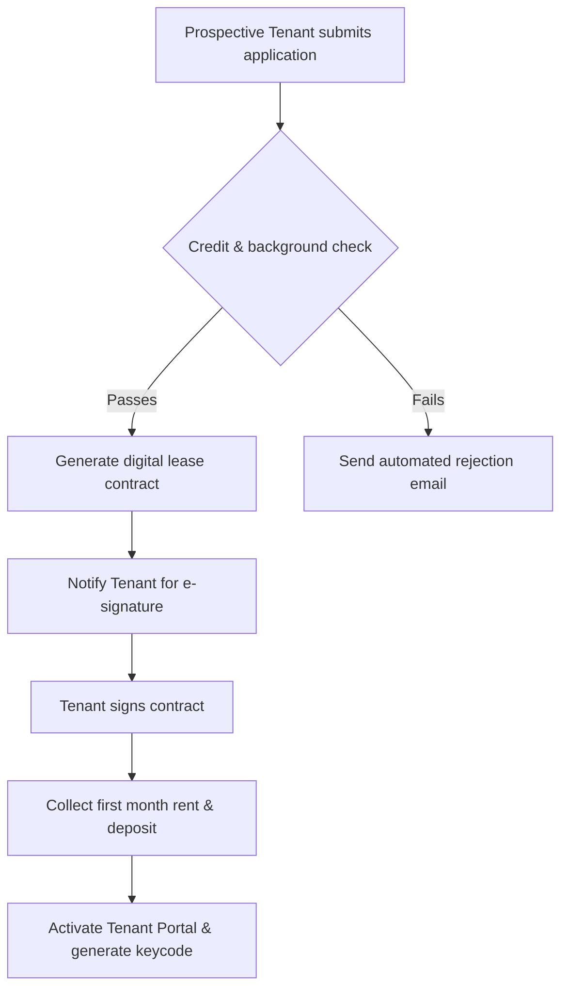

## 1. Project Background & Challenge

The client, a large-scale real estate firm managing over 10,000 residential units, struggled with a legacy management portal. Key issues included:

- **Operational Lag**: Setting up a new tenant contract required navigating through 12 separate screens, leading to a high frequency of data entry errors.
- **Lack of Transparency**: Tenants could not track maintenance requests, resulting in clogged customer support channels.
- **Disconnected Data Systems**: Graphic inventory databases and financial ledger systems were isolated, requiring manual cross-referencing.

The objective was to analyze the existing system architecture, redesign the user workflows, and prototype a consolidated dashboard interface that could scale from mobile to desktop.

---

## 2. System Analysis & Architecture

To address the business bottlenecks, a thorough system audit was conducted to refine operational flows.

### Use Case Breakdown

- **Tenant Portal**: View bills, submit maintenance requests, renew leases.
- **Property Manager Dashboard**: Track unit availability, log compliance documents, approve maintenance requests, assign vendor technicians.
- **Accounting Console**: Sync bank statements, automate invoices, view dynamic reports.

### BPMN Workflow (Improved Tenant Onboarding)

Below is the optimized flow diagram representation for tenant onboarding:

---

## 3. Visual UI/UX Solution

With the business logic defined, we designed a unified interface system focusing on scannability, ease of data entry, and aesthetic consistency.

### Wireframing & Information Architecture

We reduced the tenant onboarding process from 12 screens to a 3-step wizard layout:

1.  **Unit Selection & Tenant Details**: Collapsible forms showing dynamic rent pricing.
2.  **Contract Terms & Compliance Uploads**: Drag-and-drop slots with automatic file validation.
3.  **Payment Setup & Final Review**: Split-screen showing estimated monthly breakdown alongside checkout option.

### Design Tokens & Aesthetics

- **Primary Brand Colors**: Deep Navy Blue (`#0f172a`) for architectural structure, Forest Emerald Green (`#059669`) for positive actions (active contracts, paid bills).
- **Typography**: Clean sans-serif sans interface fonts (Inter, SF Pro) with high contrast levels matching WCAG AA accessibility standards.
- **Interactive Components**: Hover scaling effects (1.02x scaling) on cards, skeleton loading states, and micro-animations for system feedback.
