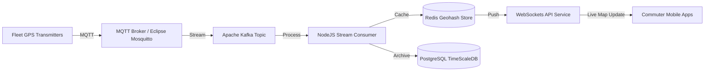

## 1. Project Background & Challenge

The municipal transit authority of a major metropolitan city required a modern system to ingest, process, and publish real-time telemetry from a fleet of 1,200 buses and 15 subway lines. The existing system relied on polling-based telemetry that lagged by up to 3 minutes, causing frustration for commuters relying on mobile applications.

The challenge was to define a publish-subscribe architecture capable of processing 10,000 coordinates per second with sub-second latency, while keeping operational costs under a strict budget.

---

## 2. System Analysis & Architecture

We analyzed data formats, frequency of coordinate updates, and ingestion mechanisms to build a robust architecture.

### Architectural Diagram

Below is the data pipeline architecture proposed:

### Data Payload Definition

To minimize bandwidth overhead, we transitioned the data format from verbose JSON to protocol buffers (Protobuf), achieving a 78% payload size reduction.
